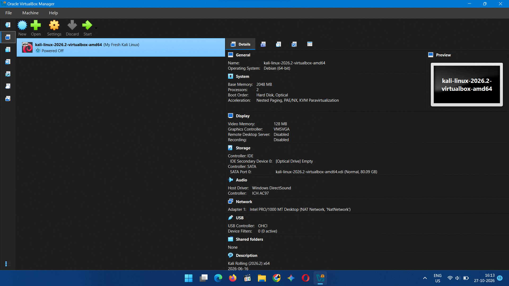
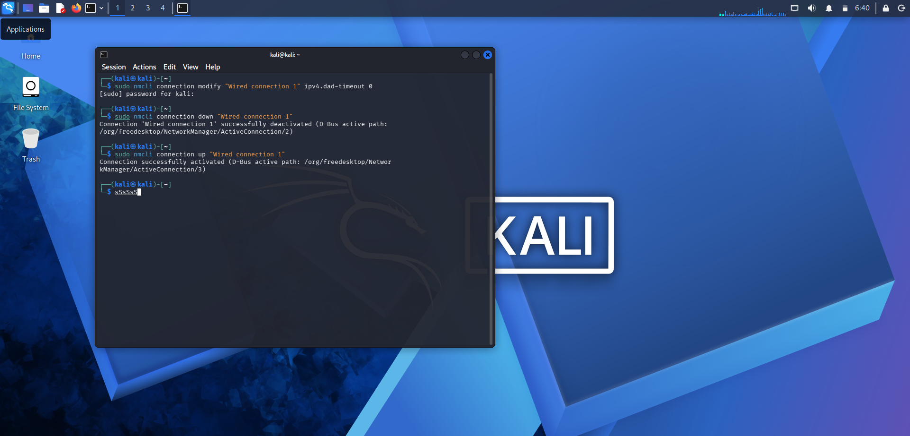

# 🔐 Cybersecurity Lab Environment Setup

### NETWORKWALKS Cybersecurity Program — Week 1

Building a virtual cybersecurity and penetration-testing lab using Oracle VirtualBox and Kali Linux.

---

## 📌 Project Overview

This project documents the setup and configuration of a virtual cybersecurity laboratory using **Oracle VirtualBox** and **Kali Linux 2026.2**.

The objective is to create a controlled virtual environment for learning cybersecurity fundamentals, understanding virtual networking, and preparing for future penetration-testing and security assessment exercises.

The lab uses a dedicated VirtualBox NAT Network and a manually configured IPv4 address for the Kali Linux virtual machine.

## 🎯 Objectives

- Install and configure Oracle VirtualBox.
- Import and configure the Kali Linux virtual machine.
- Create a dedicated NAT Network in VirtualBox.
- Configure the Kali Linux network adapter.
- Assign a static IPv4 address to Kali Linux.
- Configure the subnet mask, default gateway, and DNS server.
- Understand basic virtual networking concepts.
- Document the configuration process with screenshots.
- Prepare the environment for future authorized cybersecurity labs.

## 🛡️ Purpose of the Lab

This virtual lab provides a controlled environment for cybersecurity learning and experimentation.

It will serve as a foundation for future activities, including:

- Network reconnaissance and scanning.
- Linux networking and command-line practice.
- Network traffic analysis.
- Vulnerability assessment.
- Web application security testing.
- Penetration-testing fundamentals.

**Important:** All future security testing will be conducted only against systems that I own or have explicit authorization to test.

---

## 🏗️ Lab Architecture

The current environment consists of a Windows host running Kali Linux as a virtual machine through Oracle VirtualBox.

```text
+-------------------------------------------+
|              Host Computer               |
|               Windows 11                 |
|                                           |
|        +------------------------+         |
|        |    Oracle VirtualBox   |         |
|        |                        |         |
|        |   +----------------+   |         |
|        |   |   Kali Linux   |   |         |
|        |   |    2026.2      |   |         |
|        |   |                |   |         |
|        |   | Static IP:     |   |         |
|        |   | 10.0.0.2/24    |   |         |
|        |   +--------+-------+   |         |
|        |            |           |         |
|        |       NAT Network      |         |
|        |       10.0.0.0/24      |         |
|        +------------+-----------+         |
|                     |                     |
|               Virtual Gateway             |
|                 10.0.0.1                  |
+-------------------------------------------+
```

The architecture represents the current single-VM setup. Additional virtual machines can be connected to the same NAT Network in future labs.

---

## ⚙️ Lab Configuration

| Component | Configuration |
|---|---|
| Host Operating System | Windows 11 |
| Virtualization Platform | Oracle VirtualBox |
| Guest Operating System | Kali Linux 2026.2 |
| VM Architecture | 64-bit |
| Allocated RAM | 2048 MB (2 GB) |
| Virtual CPUs | 2 |
| Virtual Disk | Approximately 80 GB |
| Network Mode | NAT Network |
| Virtual Network Name | `NatNetwork` |
| IPv4 Network | `10.0.0.0/24` |
| DHCP Server | Enabled on VirtualBox NAT Network |
| Kali IPv4 Address | `10.0.0.2` |
| Subnet Prefix | `/24` |
| Subnet Mask | `255.255.255.0` |
| Default Gateway | `10.0.0.1` |
| Configured DNS Server | `10.0.0.1` |
| IPv6 | Disabled in the NAT Network settings |

*Note: These values reflect the configuration visible in my screenshots. Network connectivity and DNS resolution must be verified separately.*

---

## 🪜 Lab Setup Procedure

### Step 1: Set Up Oracle VirtualBox

Oracle VirtualBox was used to create and manage the virtual machine.

The Kali Linux virtual machine was imported into VirtualBox and configured with the required virtual hardware resources.

**Configuration:**
- RAM: 2048 MB
- Virtual CPUs: 2
- Virtual Disk: Approximately 80 GB
- Graphics Controller: VMSVGA

### Step 2: Configure the NAT Network

A dedicated NAT Network was configured through VirtualBox's Network Manager.

**Network settings:**

| Setting | Value |
|---|---|
| Network Name | `NatNetwork` |
| IPv4 Prefix | `10.0.0.0/24` |
| DHCP | Enabled |
| IPv6 | Disabled |

A NAT Network allows virtual machines attached to the same network to communicate with one another and provides network address translation for external connectivity, subject to the host's network access and firewall configuration.

This setup can be extended with additional virtual machines for future security exercises.

### Step 3: Configure the Kali Linux Virtual Machine

The Kali Linux 2026.2 virtual machine was started successfully in VirtualBox.

The virtual machine was configured to use the `NatNetwork` virtual network.

**Virtual machine details:**

- Operating System: Kali Linux 2026.2
- Network Adapter Type: Intel PRO/1000 MT Desktop
- Network Attachment: NAT Network
- Network Name: `NatNetwork`

### Step 4: Configure a Static IPv4 Address

The IPv4 settings for `Wired connection 1` were configured manually using the Kali Linux Network Manager.

**IPv4 configuration:**

```text
IP Address:    10.0.0.2
Subnet Mask:   255.255.255.0
Prefix Length: 24
Gateway:       10.0.0.1
DNS Server:    10.0.0.1
```

The connection was saved and reactivated to apply the network configuration.

The following command was also used during troubleshooting:

```bash
sudo nmcli connection modify "Wired connection 1" ipv4.dad-timeout 0
```

The connection was then restarted:

```bash
sudo nmcli connection down "Wired connection 1"
sudo nmcli connection up "Wired connection 1"
```

The terminal screenshot shows that NetworkManager reported successful deactivation and reactivation of the connection.

**Note:** Successful activation confirms that the connection was enabled; it does not by itself prove that gateway access, Internet connectivity, or DNS resolution is working.

---

## 🔎 Network Verification

The following checks can be used to verify the configuration and connectivity of the Kali Linux virtual machine.

### 1. Check the Network Interface

```bash
ip addr
```

Displays the available network interfaces and their assigned IP addresses.

### 2. Check the Routing Table

```bash
ip route
```

Displays the configured routes and default gateway.

### 3. Check the Gateway

```bash
ping -c 4 10.0.0.1
```

Tests connectivity to the configured virtual gateway.

### 4. Check Internet Connectivity

```bash
ping -c 4 1.1.1.1
```

Tests connectivity to an external IP address, provided outbound access is available.

### 5. Check DNS Resolution

```bash
getent hosts kali.org
```

Checks whether the configured DNS setup can resolve a domain name.

### 6. Check NetworkManager Status

```bash
nmcli connection show --active
```

Displays the currently active network connections.

### Verification Status

- [x] Kali Linux VM imported and started.
- [x] VirtualBox NAT Network configured.
- [x] Static IPv4 settings entered.
- [x] NetworkManager connection successfully reactivated.
- [ ] Gateway connectivity verified.
- [ ] Internet connectivity verified.
- [ ] DNS resolution verified.

The final three checks should be marked complete after running the commands and confirming the results.

---

## 📸 Screenshots and Evidence

The following screenshots document the lab setup process.

### 1. VirtualBox and Kali Linux Setup



Shows the Kali Linux virtual machine and its configuration in Oracle VirtualBox.

### 2. VirtualBox NAT Network Configuration


Shows the `NatNetwork` configuration, including the IPv4 prefix `10.0.0.0/24`, enabled DHCP, and disabled IPv6.

### 3. Kali Linux IPv4 Configuration


Shows the manually configured IPv4 address, subnet mask, gateway, and DNS server.

### 4. NetworkManager Connection Activation



Shows the commands used to update the connection and the successful deactivation and reactivation messages from NetworkManager.

---

## 💡 Key Learnings

### 1. Virtualization

Learned how to run Kali Linux as a virtual machine without replacing the host operating system.

### 2. NAT Network

Learned how a VirtualBox NAT Network can connect multiple virtual machines on a shared virtual network while supporting outbound connectivity.

### 3. IPv4 Addressing

Practised configuring an IPv4 address, subnet mask, gateway, and DNS server manually.

### 4. NetworkManager

Learned how to modify a network connection using `nmcli` and reactivate it to apply configuration changes.

### 5. Network Troubleshooting

Learned that an active network connection does not necessarily mean that the gateway, Internet access, and DNS are all functioning correctly.

### 6. Technical Documentation

Practised documenting the lab environment, configuration values, troubleshooting commands, and supporting screenshots in GitHub Markdown.

---

## 🐞 Troubleshooting Notes

### Network Connection After Static IP Configuration

A manually configured IP address may not provide connectivity if the gateway, DNS server, network attachment, or subnet configuration is incorrect.

Useful diagnostic commands include:

```bash
ip addr
ip route
nmcli device status
nmcli connection show --active
```

Verify that the Kali Linux network adapter is attached to the intended NAT Network and that the configured gateway matches the virtual network configuration.

### DNS Resolution Issues

If IP connectivity works but domain names do not resolve, inspect the DNS configuration and test resolution separately.

```bash
cat /etc/resolv.conf
getent hosts kali.org
```

A successful ping to an IP address alone does not confirm that DNS is working.

---

## 🔐 Security and Ethical Use

This laboratory is intended for educational purposes and authorized cybersecurity practice.

- Test only systems you own or have explicit permission to assess.
- Keep experimental activities within the intended lab environment.
- Avoid exposing vulnerable virtual machines to untrusted networks.
- Create a clean VirtualBox snapshot before making significant changes.
- Never upload passwords, API keys, private keys, or other sensitive information to GitHub.

---

## 🔗 Tools and Resources

- [Oracle VirtualBox](https://www.virtualbox.org/wiki/Downloads)
- [Official Kali Linux Downloads](https://www.kali.org/get-kali/)
- [Kali Linux Documentation](https://www.kali.org/docs/)
- [NetworkManager Documentation](https://networkmanager.dev/docs/)

---

## 👤 Author

**Mohammed Riyaan**

Computer Science and Engineering Student  
Cybersecurity Learner | Aspiring Cybersecurity Professional

**Program:** NETWORKWALKS Cybersecurity Program  
**Week:** 01  
**Project:** Cybersecurity Lab Setup  
**Tools:** Oracle VirtualBox, Kali Linux, NetworkManager

---

## 📌 Conclusion

Successfully configured the initial Kali Linux virtual machine environment and created a dedicated VirtualBox NAT Network. A static IPv4 configuration was entered, and the Kali Linux network connection was successfully reactivated.

This lab establishes the foundation for future hands-on cybersecurity exercises, network troubleshooting, and authorized penetration-testing practice.

**Next Step:** Verify gateway connectivity, Internet access, and DNS resolution, then create a clean VM snapshot before proceeding to the next lab.

